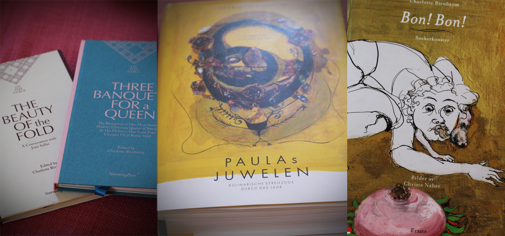

Charlotte Birnbaums passion för matkonstens ofta bortglömda hantverk är både inspirerande och smittsam. Till fika med kaffe och cocostopp bjuds jag på fascinerande berättelser om socker, inälvor, servettvikning och mycket mer. För varje samtalsämne finns det dessutom minst en bok i serien “On the Table”, som Birnbaum är redaktör för. Böcker som konstnären Christa Näher har formgivit till små konstverk i sig.

## ”Three Banquets for a Queen”, ”The Beauty of the Fold”, “Paulas Juwelen” & “Bon! Bon!”

Charlotte Birnbaum är redaktör för SternbergPress ”On the Table”, en bokserie som fokuserar på kokkonst, extravaganta middagar, spektakulära dukningar och andra besläktade områden. En av seriens titlar – den första som Charlotte plockar fram – är ”Three Banquets for a Queen”. Boken är ett historiskt dokument som återfanns för 15 år sedan och som återberättar de banketter som hölls till Drottning Kristinas ära under hennes besök i Rom. Alla menyer finns kvar, ett 100-tals rätter där maten var mer skulpturer och skådebröd än ätbar.

– Jag vill hylla konditorernas kreativitet och fantasi. De var med och skapade de mest spektakulära matupplevelser. Konstnärer som Bernini och Leonardo gjorde även de sockerskulpturer. Det var ett material på modet, förgängligt, men attraktivt.
Hur kom du in på att göra konst/kokböcker?

– Jag älskar att äta, mumsandes på en cocostopp. Det är grunden till allt för mig. Jag tycker det är så spännande det som sker på matbordet, det är en ny utställning varje dag som man ibland delar och ibland åtnjuter själv. Jag har läst både konstvetenskap och teatervetenskap och för mig är matbordet ”Teatern på bordet”. Bordet är scenen och maten blir till scenografi eller skulpturer och sedan förhåller sig matgästen till denna teater.

Här tar Charlotte upp ”The Beauty of the Fold: A Conversation with Joan Sallas” och beskriver Joan Sallas som servettvikningens Carl von Linné och ensam i sitt slag.

– Han har katalogiserat alla vikningar och namngett och dokumenterat dem i denna bok. Han började sitt arbete i en källare, men har nu kommit fram i all sin glans och ställde ut på Hallwylska palatset i Stockholm för ett par år sedan.

## ”Pies, Pâtés and Pasteries”

Kan du berätta mer om dina böcker? Frågar jag och hinner ta en klunk kaffe och en tugga av bakverket, som Charlotte noggrant påpekat att hon inte bakat själv, medan värdinnan hämtar sin bok ”Pies, Pâtés ans Pasteries: Secrets Old and New of the Art och Cooking”, som är ett verk om pastejer.

– Pastejer är både fattigmansmat och har varit en självklar del i finrummets bjudningar. Till denna bok läste jag om alla möjliga typer av pastejer, en gång hade man under 1400-talet bakat in en hel orkester i en pastej, tillsammans med ett bankettbord fullt av mat.

– Menar du en riktig orkester med levande människor, måste jag fråga?

> Pastejen öppnades och ut kom fåglar, grodor, ålar och det var inte ovanligt med lättklädda damer eller sjungande pojkar i pastejerna.

– Ja! Det var inte alls ovanligt att man bakade in underhållning eller samtalsunderlättare i maträtten. Pastejen öppnades och ut kom fåglar, grodor, ålar och det var inte ovanligt med lättklädda damer eller sjungande pojkar i pastejerna. Men vanligast var att man hade dvärgar i pastejen. De kom ut och hälsade gästerna med fanor och många kungahus hade favoritdvärgar som man kunde låna till speciella banketter.

– Aristoteles skrev om pastejens roll under skådespelen i Aten, där fanns de till försäljning i kiosker, lite som vi har korvkiosker utanför arenor idag. Aristoteles beskriver att det var främst under de tråkigare partierna i teaterstycket som pastejerna gick åt. Och det fanns alla möjliga typer av pastejer. Idag tänker vi kanske främst på leverpastej, men det finns inga gränser för vad som kan bakas in i denna rätt. De kan vara vegetariska, söta, fyllda med fisk. Jag läste om en engelsk hustru som till sin man gjort en pastej med hans initialer på och som var uppdelad i tre, en del var varmrätt, en förrätt och en tredje del efterrätt.

Charlotte berättar att alla recept i sina böcker har hon gjort själv, om det inte står något annat. Och hon har gjort dem enkla,

– Jag är själv halvbra på att laga mat, jag föredrar att sitta på dammiga bibliotek och göra research.

## ”Den inre resan”

**Vilken var din första bok?**
– Det var boken om inälvsmat. Jag satt på Grythyttans bibliotek där Tore Vretmans stora kokbokssamling finns. Jag hade inte råd att bo på det fina värdshuset i Grythyttan, utan hyrde in mig på ett hönseri. Efter en tid när jag börjat på boken så flyttade jag och familjen till Tyskland och då var jag fast besluten om att fortsätta skriva, men på tyska. Det var så lärde jag mig språket, jag kunde inte tyska innan och om man läser tyska recensioner av ”Den inre resan” så nämner flera att jag har ett särskilt språk när jag skriver, men det är antagligen bara för att jag lärde mig allt eftersom, skrattar Charlotte.

## ”Bon! Bon!”

**När började du samarbeta med Christa Näher som illustratör?**

– Jag började arbeta med Christa Näher redan från första boken, 2008. Jag hade sett hennes konst tidigare och älskade den. Vi jobbar väldigt nära. Hon bor i syd-Tyskland, men vi skickar saker tillvarandra ofta. Och det är ett levande samarbete, ibland skickar hon bilder till mig som jag hittar historier och recept till och ibland är det tvärt om.

**Berätta om din senaste bok**
– Min senaste bok kom ut förra året, 2013 och heter ”Paulas Juwelen : Kulinarische Streifzüge durch das Jahr” (ungefärligt översatt: ”Paulas Juveler: kulinarisk vandring över ett år”). Den följer årstiderna i råvaror och jag har gett varje dag en egen berättelse, ett recept eller något annat inspirerat av en historisk händelse, en årsdag, dödsdag, födelsedag eller liknande. Ett exempel är 3e april där följande citat står “Essen macht Spaß, viel Essen macht viel Spaß. – Unbekannt” (ungefärligt översatt: ”Att äta är roligt, att äta mycket är mycket roligt” – okänd)

– Än så länge finns denna bok endast på tyska, men jag hoppas kunna översätta den snart.

– ”Paulas Juwelen” har lämnat ett litet tomrum efter sig, säger Charlotte. Jag hade samlat på mig många berättelser under åren som fann sin plats i denna bok. Andra har jag fått leta aktivt efter i historieböcker, kokböcker, politiska skrifter, mode med mera. Just nu, när boken precis har gått till tryck, blir det som en separation.

Charlotte tar fram en historisk kokbok som vi bläddrar i tillsammans.

– Att uppleva historien utifrån maten man åt tycker jag är idéhistoriskt intressant. Mest bevarat finns från överklassen, maten var reklam för dem själva. De ordnade sockerbanketter för att förhärliga sig själva, men även för att bedriva politik. Hade de en borg med en viss arkitektur med i sitt sockerlandskap kunde det betyda att de skulle angripa exempelvis Turkiet.
– Det finns även bevis att romarna kunde ge sina barn en kaka med bokstäver på och när de lärt sig sitt ABC fick de äta upp kakan som belöning.

## ”Diners de Gala”

DinerDeGalasFinns det någon du skulle vilja samarbeta med, levande som död?

– Salvador Dali! Han skrev den fantastiska ”Les Diners de Gala” tillsammans med kockarna på Maxim. Den är fylld av fantastifyllda banketter som det vore en dröm att få skapa något i verkligheten av.

**Vem inspirerar dig?**
– Christa inspirerar mig verkligen. Och jag gillar det barocka.

**Vilken maträtt skulle du vilja lyftas fram idag till en större publik?**
– Pastejen! Jag tycker surdeg och korv har haft sin tid och nu är det dags för pastejen. Det är ett bra sätt att ta hand om rester. Frågar du mig så tycker jag att vi måste äta mindre kött i väst, men när vi väl äter så ska vi äta hela djuret och då kan pastej vara kul.

## ”Futurist Cookbook”

**Vad har du på gång nu?**
– Jag ska skriva förordet till nyöversättningen av den italienska futuristen Filippo Tommaso Marinettis bok ”Den futuristiska kokboken” som ska ges ut i ”On the Table”-serien. Marinetti var en galenpanna som hade en problematisk relation till Moussolini och som italiensk futurist var han väldigt inne på FuturistCoocBookfart, framtid och att allt gammalt skulle rensas bort.

I kokboken skapar han en ny vokabulär för maträtter – han ville byta ut de franska mat-orden till italienska.

– Och så skulle jag vilje göra en ”Paulas Juwelen”, fast med dryck.

När vårt samtal går mot sitt slut är den stora soffan hemma hos Charlotte Birnbaum täckt av böcker, hennes egna så väl som andras. Texter om konst, mat, politik och kärlek som tillsammans med konversationen har förändrat min syn på vad mat kan vara för alltid.

I dagens flod av kommersiella kokböcker och destruktiva diethets är böcker som ”Bon Bon: sockerkonster” och ”Den inre resan: en kokbok om matlagning med inälvor” kreativa oaser där mat får stå fri från samtidens begränsningar. En inre resa som jag aldrig vill komma tillbaka ifrån.
